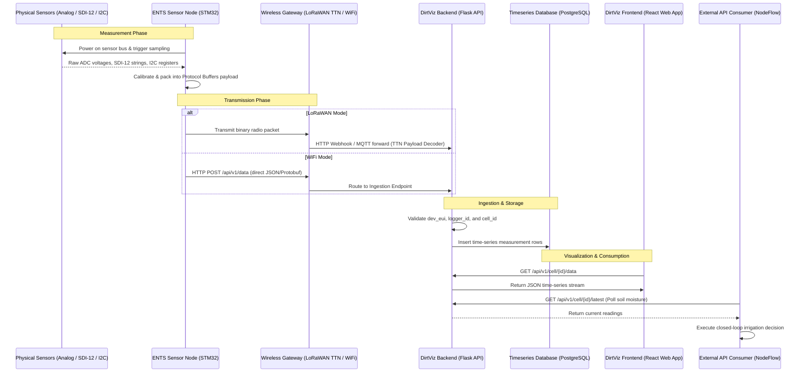

# System Architecture

This document specifies the end-to-end dataflow, hardware-to-cloud interfaces, serialization protocols, and API integration patterns across the ENTS ecosystem.

---

## End-to-End Data Pipeline

The ENTS telemetry pipeline streams environmental measurements from physical analog and digital probes to the cloud visualization service:



---

## 1. Sensing Frontend and Sampling

The ENTS sensing node integrates three distinct measurement interfaces:

* **Differential Analog Frontend**:
  * Dual-channel instrumentation amplifier and precision ADC.
  * Measures low-voltage differential potentials (down to sub-millivolt ranges) across microbial fuel cells or electrochemical substrates.
  * Measures voltage drop across a precision shunt resistor ($R_{\text{sense}} = 2\text{ k}\Omega$) for ultra-low current monitoring.
* **SDI-12 Serial Bus**:
  * Standard digital interface for commercial agricultural and environmental sensors (such as METER TEROS 11/12 probes).
  * The microcontroller bit-bangs the SDI-12 protocol over a bidirectional single-wire bus at 1200 baud, querying addressable probes for moisture, temperature, and electrical conductivity.
* **I2C Bus**:
  * Standard 2-wire serial interface operating at 100 kHz or 400 kHz.
  * Queries onboard and external environmental sensors (e.g., barometric pressure, ambient temperature, relative humidity).

---

## 2. Serialization and Protocol Buffers

Measurement records are structured using Protocol Buffers (`proto/`) to ensure consistent, strongly typed serialization across firmware languages (C/C++ in bare-metal, Nanopb in Tock, and Python in DirtViz):

```protobuf
syntax = "proto3";

package ents;

message SensorMeasurement {
    uint32 timestamp = 1;
    uint32 logger_id = 2;
    uint32 cell_id = 3;

    // Analog measurements
    float voltage_mv = 4;
    float current_ua = 5;

    // Digital environmental measurements
    float soil_moisture_vwc = 6;
    float soil_temperature_c = 7;
    float ambient_temperature_c = 8;
    float relative_humidity_pct = 9;
}
```

* **Bare Metal Firmware**: Uses [Nanopb](https://jpa.kapsi.fi/nanopb/) to compile compact C structs with zero dynamic memory allocation.
* **LoRaWAN Framing**: Over LoRaWAN, where airtime is constrained, measurements are packed into compact fixed-width bitfields decoded by a server-side JavaScript payload formatter in The Things Network.

---

## 3. Wireless Ingestion Pipelines

### LoRaWAN Pipeline
1. The STM32 microcontroller packages measurements and drives the onboard Semtech SX1262 LoRa transceiver.
2. Packets are broadcast using LoRaWAN Class A protocol to nearby public or private gateways.
3. The Things Network (TTN) decodes the packet using the ENTS payload formatter and delivers the decoded JSON payload to DirtViz via an HTTP Webhook integration.

### WiFi HTTP Ingestion Pipeline
1. For indoor or laboratory setups with WiFi access, the board's ESP32 co-processor establishes an 802.11 b/g/n link.
2. The ESP32 formats measurements as an HTTP POST request to the DirtViz ingestion endpoint (`/api/v1/data`).
3. DirtViz verifies authentication headers and commits the record.

---

## 4. DirtViz Cloud Architecture

The DirtViz platform ([jlab-sensing/DirtViz](https://github.com/jlab-sensing/DirtViz)) consists of four core services managed via Docker Compose:

* **Backend Service**: Python Flask REST API responsible for handling data ingestion, authentication, database migrations, and telemetry queries.
* **Database Service**: PostgreSQL database optimized for time-series sensor data indexing.
* **Frontend Service**: React single-page application providing responsive dashboards, interactive Plotly charts, and administrative panels.
* **Reverse Proxy**: NGINX routing incoming traffic, handling SSL termination, and serving static assets.

---

## 5. API Consumption Pattern: The NodeFlow Derivative

The DirtViz REST API is designed not only to serve its React web interface, but also to support external automated control systems.

### NodeFlow Case Study
**NodeFlow** ([jlab-sensing/NodeFlow](https://github.com/jlab-sensing/NodeFlow)) is an open-source automated irrigation platform derived from the DirtViz ecosystem:

1. **Telemetry Polling**: NodeFlow runs on an edge controller (such as a Raspberry Pi or local server) and periodically queries the DirtViz API for current soil moisture readings from specified Cell IDs:
   ```http
   GET /api/v1/cell/14/latest HTTP/1.1
   Host: dirtviz.jlab.ucsc.edu
   Authorization: Bearer <API_TOKEN>
   ```
2. **Response Parsing**: DirtViz returns real-time calibrated volumetric water content (VWC) measurements recorded by field ENTS nodes.
3. **Closed-Loop Actuation**: If the measured VWC falls below an agronomically defined threshold, NodeFlow triggers local relay actuators to open solenoid valves and deliver water, continuing until the target moisture level is restored.

NodeFlow serves as the canonical reference implementation illustrating how external control systems can leverage ENTS sensing nodes and the DirtViz cloud API for real-time automation.
