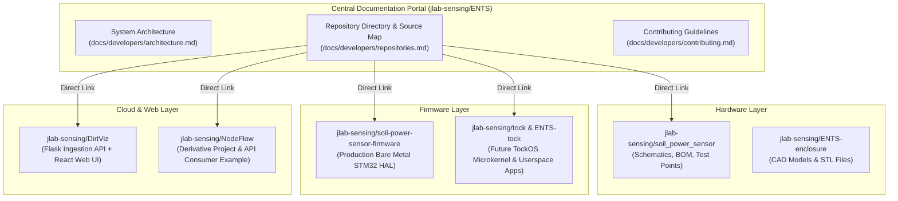

# Developer Hub Overview

Welcome to the ENTS Developer Hub. The ENTS project encompasses an ecosystem of open-source repositories spanning custom hardware design, dual embedded firmware architectures, cloud ingestion pipelines, and interactive web visualization.

---

## Architecture and Source Code Organization

To support continuous improvement across heterogeneous embedded and web stacks without documentation drift, the ENTS ecosystem enforces a strict **Single Source of Truth** documentation model:

* **Central Portal (`jlab-sensing/ENTS`)**: Focuses on high-level system architecture, cross-cutting data pipelines, end-to-end integration workflows, and the overall repository index.
* **Subsystem Repositories**: Maintain code-adjacent developer documentation (such as `pytest` commands, PlatformIO flags, Rust compilation targets, and hardware assembly notes) directly alongside their source code.

---

## Developer Guides in this Section

* **[System Architecture](architecture.md)**: Detailed specification of end-to-end dataflow, measurement frontend pipelines, Protocol Buffer serialization, wireless transmission protocols, and cloud ingestion.
* **[Repository Directory and Source Map](repositories.md)**: Complete catalog of all repositories across the ENTS ecosystem, detailing primary languages, subsystem roles, direct links to canonical Markdown documentation, and a clear distinction between core projects, derivatives (NodeFlow), and unsupported community tools.
* **[Contributing and Community](contributing.md)**: Guidelines for contributing code, formatting standards, testing expectations, and reporting issues.

---

## Local Development Quick Links

For environment setup and compilation instructions for individual subsystems, navigate directly to the canonical documentation within each repository:

* **DirtViz Web and Backend**: [DirtViz Development Guide](https://github.com/jlab-sensing/DirtViz/blob/main/docs/development.md)
* **Bare Metal Firmware (STM32 HAL)**: [Firmware Developer Guide](https://github.com/jlab-sensing/soil-power-sensor-firmware/blob/main/README.md)
* **TockOS Kernel**: [Tock wm1110dev Board Documentation](https://github.com/jlab-sensing/tock/blob/master/boards/wm1110dev/README.md)
* **TockOS Userspace Applications**: [ENTS-tock Userspace README](https://github.com/jlab-sensing/ENTS-tock/blob/main/README.md)
* **Hardware PCB and Assembly**: [Soil Power Sensor Hardware Guide](https://github.com/jlab-sensing/soil_power_sensor/blob/main/README.md)
* **NodeFlow Irrigation System**: [NodeFlow README](https://github.com/jlab-sensing/NodeFlow/blob/main/README.md)
