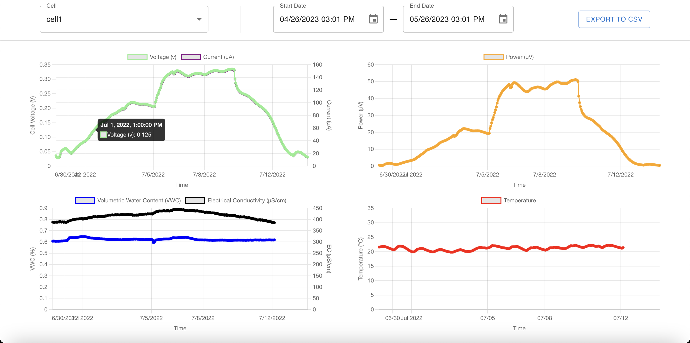
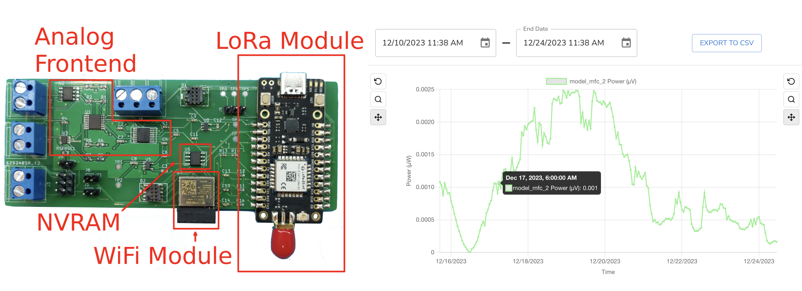
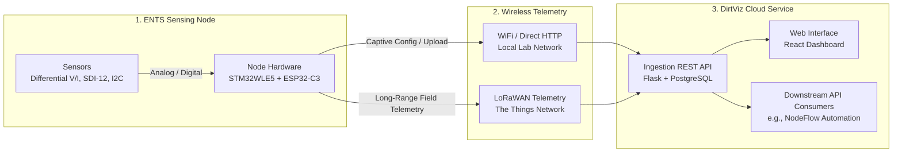

# ENTS: Environmental NeTworked Sensing

An open-source ecosystem for building low-cost, extensible, and field-ready environmental wireless sensor networks.

Co-designed with domain scientists at UC Santa Cruz, ENTS supports researchers and practitioners across environmental sciences, agroecology, and embedded systems by providing end-to-end sensing infrastructure from custom hardware to cloud visualization.

---

## Live Cloud Platform: DirtViz

The central cloud visualization and monitoring service for the ENTS ecosystem is live at **[dirtviz.jlab.ucsc.edu](https://dirtviz.jlab.ucsc.edu/)**.

  <h3>Operational Cloud Service: DirtViz</h3>
  

    DirtViz is the production data ingestion and visualization platform for ENTS. It aggregates live measurements from outdoor sensor nodes, dynamically renders time-series graphs, and provides public and authenticated access to environmental datasets for research.
  

  

    <a href="https://dirtviz.jlab.ucsc.edu/" class="md-button md-button--primary" target="_blank" rel="noopener">Open Live DirtViz Platform &rarr;</a>
    <a href="users/dirtviz.md" class="md-button">DirtViz User Guide &rarr;</a>
  

<figure class="figure-wide">
  
  <figcaption><strong>Figure 1:</strong> The DirtViz web dashboard presents live interactive plots from field-deployed ENTS sensing nodes, with custom time-range filtering, streaming modes, and CSV export capabilities.</figcaption>
</figure>

---

## Getting Started

Select the pathway that matches your goals:

-   **For Users and Field Deployers**

    ---

    Deploy and configure ENTS hardware nodes in the field, wire sensors, and visualize measurements in the DirtViz web application.

    [:octicons-arrow-right-24: Open User Guide](users/index.md)

-   **For Developers and Contributors**

    ---

    Understand the system architecture, explore the multi-repository source code directory, and set up development environments.

    [:octicons-arrow-right-24: Open Developer Hub](developers/index.md)

---

## System Overview

The ENTS platform connects physical environmental sensors to researchers through an integrated hardware, firmware, and cloud data pipeline.

<figure class="figure-wide">
  
  <figcaption><strong>Figure 2:</strong> End-to-end system overview of the ENTS ecosystem. Field-deployed hardware nodes (left) collect precision electrical and environmental telemetry, which is transmitted via LoRaWAN or WiFi into the DirtViz cloud backend and React frontend (right).</figcaption>
</figure>

### Architecture Dataflow

<figcaption style="margin-top: 0.5em; text-align: center; font-size: 0.85em; color: var(--md-default-fg-color--light);"><strong>Figure 3:</strong> High-level data ingestion flow from sensing hardware through dual wireless networks into DirtViz and external automation systems.</figcaption>

---

## Key Features

* **Precision Analog and Digital Sensing**: Integrated support for ultra-low power differential voltage and current measurements (soil microbial fuel cells), SDI-12 digital environmental probes (TEROS soil moisture), and standard I2C sensors.
* **Dual Wireless Connectivity**: Onboard LoRaWAN for long-range field deployments and WiFi for laboratory testing and captive portal configuration.
* **Interactive Cloud Visualization**: Centralized ingestion and visualization via the [DirtViz web application](https://dirtviz.jlab.ucsc.edu/), offering interactive plotting, real-time data streaming, and raw CSV export.
* **Extensible Ecosystem**: A documented REST API enabling automated downstream control systems such as the NodeFlow irrigation automation project.

---

## Architectural Roadmap

The ENTS platform maintains a distinct separation between current production deployments and future research:

* **Production Firmware (Bare Metal STM32 HAL)**: The stable, field-proven firmware running on the STM32WLE5 microcontroller using ST HAL and PlatformIO, paired with an ESP32 for wireless captive portal configuration.
* **Future Firmware (TockOS Architecture)**: The next-generation operating system branch built on the Tock embedded microkernel in Rust, delivering process isolation, memory safety, and fault-tolerant userspace sensor applications.

For technical details and transition goals, see the [Project Roadmap](roadmap.md).

---

## Peer-Reviewed Publications

The ENTS platform is supported by academic research published in ACM conferences:

1. **ENTS: Experiences in Co-Designed Environmental Sensing**  
   John Madden, Stephen Taylor, Laura Jaliff, Aaron Wu, Alec Levy, Jack Lin, Ahmed Falah, Tyler Potyondy, Josiah Hester, George Wells, Yaman Sangar, Pat Pannuto, and Colleen Josephson.  
   *Proceedings of the 24th ACM Conference on Embedded Networked Sensor Systems (SenSys '26)*.  
   [https://doi.org/10.1145/3774906.3802780](https://doi.org/10.1145/3774906.3802780)

2. **Demo: Hardware to Unleash Novel Energy Sources for Outdoor Sensor Networks**  
   Alec Levy, John Madden, Mirella Pessoa de Melo, and Colleen Josephson.  
   *Proceedings of the 23rd ACM Conference on Embedded Networked Sensor Systems (SenSys '25)*, pp. 706–707.  
   [https://doi.org/10.1145/3715014.3724369](https://doi.org/10.1145/3715014.3724369)

3. **Hardware to Enable Large-Scale Deployment and Observation of Soil Microbial Fuel Cells**  
   John Madden, Gabriel Marcano, Stephen Taylor, Pat Pannuto, and Colleen Josephson.  
   *Proceedings of the 20th ACM Conference on Embedded Networked Sensor Systems (SenSys / ENSsys '22)*, pp. 906–912.  
   [https://doi.org/10.1145/3560905.3568110](https://doi.org/10.1145/3560905.3568110)

For full abstracts and BibTeX citations, refer to the [Publications](community/publications.md) section.

---

## Community and Support

ENTS is an open-source collaboration developed by the [jLab in Smart Sensing](https://sensors.soe.ucsc.edu/) at the University of California, Santa Cruz.

* **Discussion and Chat**: Join the conversation on the [ENTS Zulip Chat](https://ents.zulipchat.com/).
* **Source Repositories**: Browse all ecosystem repositories in the [Repository Directory](developers/repositories.md).

---

## Funding Acknowledgements

This project and open-source ecosystem are supported in part by:

* **National Science Foundation (NSF)**: Pathways to Enable Open-Source Ecosystems (POSE) program.
* **UC Santa Cruz Agricultural Experiment Station**: Funding provided by the State of California.
* **U.S. Department of Agriculture (USDA), National Institute of Food and Agriculture (NIFA)**: Hatch Act of 1887 funding (Accession number: 7010079).
