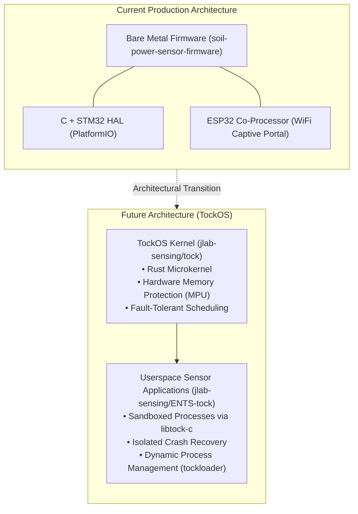

# Project Roadmap

This document outlines the architectural roadmap for the ENTS ecosystem, clarifying the relationship between current production implementations and the next-generation operating system direction.

---

## Firmware Architecture Evolution

The ENTS firmware ecosystem is transitioning from a monolithic bare-metal implementation to a modern, modular embedded operating system.

### 1. Current Production Firmware: Bare Metal (STM32 HAL)

* **Repository**: [jlab-sensing/soil-power-sensor-firmware](https://github.com/jlab-sensing/soil-power-sensor-firmware)
* **Technology Stack**: C, STM32 HAL, PlatformIO, ESP32 SDK
* **Primary Board Target**: Seeed Wio-E5 mini (STM32WLE5JC) and ESP32-C3-MINI-1
* **Characteristics**:
  * **Production-Ready**: Deployed in multi-year field research monitoring soil microbial fuel cells, cactus energy harvesting, and marshland hydrology.
  * **Monolithic Design**: Single firmware binary controlling sensor drivers, analog sampling, Protocol Buffer serialization, and LoRaWAN transmission.
  * **Low-Power Sleep Optimization**: Tuned for ultra-low sleep current consumption during quiescent periods.
  * **Dual-MCU Model**: The STM32 handles precision sensing and radio duty cycles, while the onboard ESP32 wakes on demand to provide the WiFi captive configuration portal.

For development instructions and sensor calibration specs, refer to the [Bare Metal Firmware Developer Guide](https://github.com/jlab-sensing/soil-power-sensor-firmware/blob/main/README.md).

---

### 2. Future Firmware Architecture: TockOS Modular System

* **Primary Repositories**:
  * Kernel: [jlab-sensing/tock](https://github.com/jlab-sensing/tock)
  * Userspace Applications: [jlab-sensing/ENTS-tock](https://github.com/jlab-sensing/ENTS-tock)
  * C Userspace Library: [jlab-sensing/libtock-c](https://github.com/jlab-sensing/libtock-c)
  * Flashing and Management Tool: [jlab-sensing/tockloader](https://github.com/jlab-sensing/tockloader)
* **Technology Stack**: Rust (microkernel), C (userspace applications), Python (`tockloader`)
* **Target Board**: Wio-WM1110 / STM32WLE5 (`boards/wm1110dev`)

#### Why TockOS?

As environmental sensing nodes become more complex—monitoring multiple heterogeneous sensors, handling adaptive sampling rates, and executing local edge algorithms—monolithic bare-metal firmware faces key limitations:

1. **Hardware-Enforced Memory Safety**: The Tock microkernel is written in safe Rust. It uses the ARM Cortex-M Memory Protection Unit (MPU) to isolate untrusted device drivers and user applications from each other and from the core operating system.
2. **Fault Isolation**: In bare-metal systems, a null pointer dereference or bus error in a complex digital sensor driver (such as SDI-12 or I2C) panics the entire microcontroller and halts data collection. In Tock, individual sensor drivers and telemetry loops run as isolated userspace processes. If an application crashes, the kernel restarts it automatically without disrupting other tasks or losing system state.
3. **Concurrent Multi-Tenant Applications**: Multiple independent sensing tasks can run concurrently with distinct execution priorities, timers, and storage allocations.
4. **Dynamic Loading**: Using `tockloader`, developers can install, update, or remove individual sensing applications without needing to recompile or flash the entire kernel.

#### Transition Roadmap

* **Phase 1 (Complete)**: Port TockOS kernel board support for the ENTS STM32WLE5 target (`boards/wm1110dev`).
* **Phase 2 (In Progress)**: Implement core userspace applications in `ENTS-tock` for SDI-12, I2C, analog measurement, and Nanopb configuration handling.
* **Phase 3 (Future)**: Validate long-term power profiles and deploy TockOS firmware in field pilot studies.
* **Phase 4 (Future)**: Transition primary recommendation for new deployments to TockOS as the standard firmware platform.

---

## Web Platform and API Evolution

* **Repository**: [jlab-sensing/DirtViz](https://github.com/jlab-sensing/DirtViz)
* **Live Deployment**: [https://dirtviz.jlab.ucsc.edu/](https://dirtviz.jlab.ucsc.edu/)
* **Status**: Mature, fully operational cloud service.

The DirtViz platform provides reliable time-series ingestion, PostgreSQL database persistence, Google OAuth authentication, and an interactive React web dashboard.

### API Integration and Downstream Automation

The primary focus of current web platform development is extending API consumption for external automation systems:

* **NodeFlow** ([jlab-sensing/NodeFlow](https://github.com/jlab-sensing/NodeFlow)): A direct derivative of DirtViz that implements closed-loop automated irrigation. NodeFlow serves as the canonical example of how external automation services authenticate with the DirtViz REST API, fetch real-time soil moisture telemetry, and trigger physical actuators.
* **OpenAPI / REST Documentation**: Ongoing efforts to publish formal API schema documentation to streamline third-party script development.
