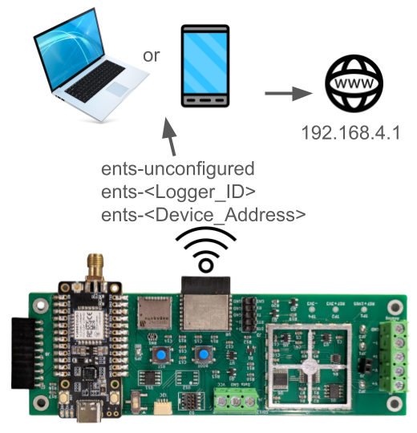
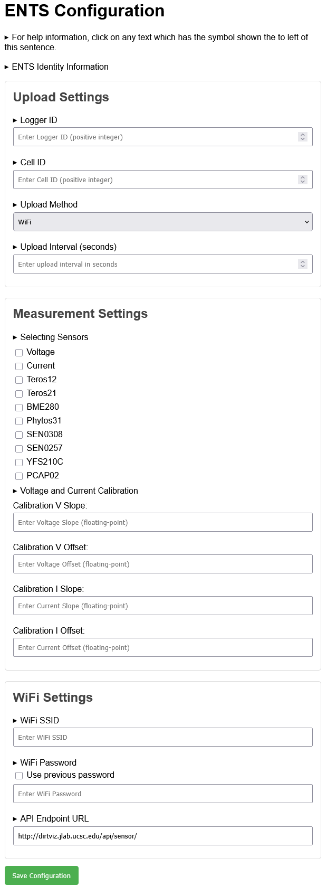

# Captive Portal Configuration

During initial boot, the ENTS board's onboard ESP32 co-processor broadcasts a temporary WiFi access point. This allows field operators to configure network credentials, telemetry channels, and cloud device identifiers without connecting cables or opening a terminal.

---

## 1. Connecting to the Configuration Hotspot

1. Connect the ENTS board to power via USB-C or a battery.
2. Wait 5 to 10 seconds for the status LED to begin blinking.
3. On your computer or mobile phone, open the available WiFi network list.
4. Locate the network named `ents-` followed by the 8-character device identifier (for example, `ents-06099AEA`). This identifier matches the MAC address printed on the white silkscreen label on the back of the PCB.

<figure class="figure-hardware">
  
  <figcaption><strong>Figure 1:</strong> Locating and connecting to the ENTS board's configuration WiFi hotspot (<code>ents-XXXXXXXX</code>) from a phone or computer.</figcaption>
</figure>

5. Connect to the network. The default password is:
   ```text
   ilovedirt
   ```
6. *Recommendation*: Disable "Auto-reconnect" on this network so your device does not reconnect automatically during field deployments.

---

## 2. Accessing the Configuration Webpage

1. Open a web browser on your connected device.
2. Navigate to:
   ```text
   http://192.168.4.1
   ```
3. The embedded configuration portal will load:

<figure class="figure-mobile">
  
  <figcaption><strong>Figure 2:</strong> The embedded web configuration page hosted by the ESP32 at <code>http://192.168.4.1</code>. Use this form to assign your Logger ID, Cell ID, measurement frequencies, and upload method (WiFi or LoRaWAN).</figcaption>
</figure>

---

## 3. Entering Configuration Parameters

Fill in the required configuration fields:

### Identity Fields
* **Logger ID**: Enter the numeric Logger ID obtained when creating your device in DirtViz (see [DirtViz Web Platform](dirtviz.md)).
* **Cell ID**: Enter the numeric Cell ID corresponding to the physical deployment site created in DirtViz.

### Telemetry and Transmission Method
Select the upload method based on your deployment environment:

* **WiFi Mode**:
  * Select `WiFi` under upload method.
  * Enter the local WiFi network name (**SSID**) and **Password**.
  * Enter the target DirtViz ingestion endpoint (defaults to `https://dirtviz.jlab.ucsc.edu/api/v1/`).
* **LoRaWAN Mode**:
  * Select `LoRaWAN` under upload method.
  * Ensure your device DevEUI, JoinEUI, and AppKey match your registration on The Things Network (TTN) or local LoRaWAN gateway.

### Measurement Timing
* **Sampling Interval**: Configure the measurement cadence (in seconds) between sampling cycles.
* **Transmission Interval**: Configure how often aggregated measurement packets are uploaded.

---

## 4. Saving and Rebooting

1. Click the green **Save Configuration** button at the bottom of the page.
2. The web interface will confirm that settings were written to onboard non-volatile memory (EEPROM / NVS).
3. Follow the onscreen prompt to reboot the board: press the white **RST** button located near the corner of the board next to the USB-C port.
4. Disconnect your phone or computer from the `ents-XXXXXXXX` WiFi network.
5. The board will now transition into its programmed sensing and transmission duty cycle.
