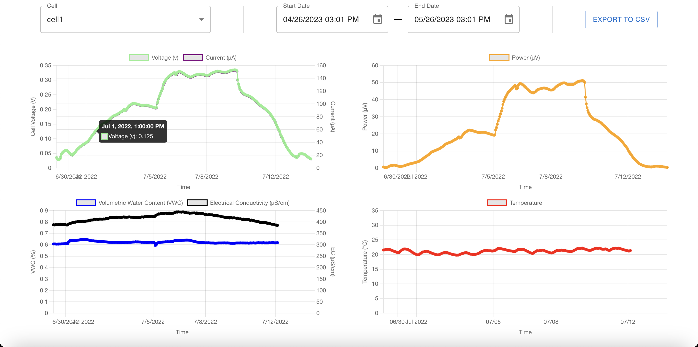

# DirtViz Web Platform Guide

[DirtViz](https://dirtviz.jlab.ucsc.edu/) is the web portal and visualization service for the ENTS ecosystem. It ingests measurements from deployed sensing nodes, stores them in a time-series database, and provides an interactive web interface for data exploration and export.

---

## 1. Account Access and Setup

1. Open your browser and navigate to [https://dirtviz.jlab.ucsc.edu/](https://dirtviz.jlab.ucsc.edu/).
2. Log in using your Google account via the OAuth sign-in button.
3. Once authenticated, click on your profile icon in the top navigation bar to open user management.

---

## 2. Managing Cells and Loggers

DirtViz separates the **physical sensing location** (Cell) from the **hardware device** (Logger):

* **Cell**: Represents the physical deployment site, experimental bed, or microbial fuel cell.
* **Logger**: Represents the specific electronic ENTS node that records measurements.

### Creating a Cell

1. In your DirtViz profile, navigate to the **Cells** tab.
2. Click **Create Cell**.
3. Fill in the required fields:
   * **Name**: A descriptive identifier for your deployment (for example, `UCSC-Farm-Bed-3`).
   * **Location / Coordinates**: Latitude and longitude for map visualization (placeholder coordinates can be used if not yet determined).
4. Click **Save**.
5. Note the generated **Cell ID** (an integer). You will enter this ID during the on-board hardware captive portal configuration.

### Creating a Logger

1. In your DirtViz profile, navigate to the **Loggers** tab.
2. Click **Create Logger**.
3. Enter the device identifiers provided with your ENTS board:
   * **DevEUI**: 16-character hexadecimal identifier.
   * **JoinEUI**: 16-character hexadecimal identifier.
   * **AppKey**: 32-character hexadecimal key.
   *(Note: These identifiers are also displayed in the serial boot output if you connect the board over USB; see [Diagnostics and LEDs](diagnostics.md)).*
4. Click **Save**.
5. Note the generated **Logger ID** (an integer). You will enter this ID during on-board captive portal configuration.

---

## 3. Visualizing Sensor Telemetry

<figure class="figure-wide">
  
  <figcaption><strong>Figure 1:</strong> DirtViz dashboard view. The navigation bar provides date range filters and live streaming controls, the map plots deployment cells, and the interactive charts plot multi-channel sensor telemetries in real time.</figcaption>
</figure>

### Dashboard Controls

1. From the main dashboard, select your **Cell** from the dropdown menu or click its pin on the interactive map.
2. Choose the measurement channels you wish to display (for example, *Voltage*, *Current*, *Power*, *Soil Moisture*, or *Soil Temperature*).
3. Select your desired time range. To view real-time data as it arrives from the field, ensure the end date is set to a future timestamp.
4. Toggle the **Livestream** button to automatically refresh the graphs as new packets are ingested.

---

## 4. Exporting Data

DirtViz provides raw CSV data downloads for analysis in external computational environments:

1. On the dashboard graph view, click the **Export CSV** button in the upper-right corner of the plot.
2. Select the date range and channels to include in the export.
3. Save the resulting `.csv` file.

### Loading Data in Python

```python
import pandas as pd
import matplotlib.pyplot as plt

# Load exported DirtViz CSV data
df = pd.read_csv("dirtviz_export.csv", parse_dates=["timestamp"])
df.set_index("timestamp", inplace=True)

# Display basic statistics
print(df.describe())

# Plot measurements
df.plot(subplots=True, figsize=(10, 6))
plt.tight_layout()
plt.show()
```
