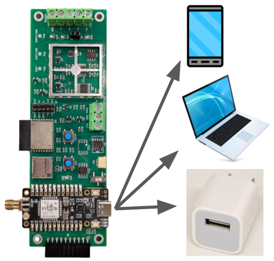
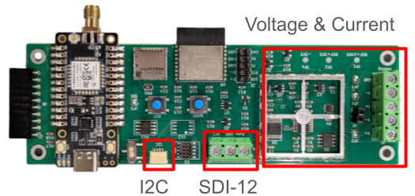

# Hardware Setup and Wiring

This document describes how to power the ENTS sensing node, connect digital and analog sensors, and wire measurement circuits.

---

## 1. Powering the Board

The ENTS sensor board can be powered through either USB-C or a dedicated external battery connector.

<figure class="figure-hardware">
  
  <figcaption><strong>Figure 1:</strong> Powering the ENTS node. Connect via the USB-C port (left) to a 5V charger or host computer, or connect a 3.7V battery to header J9. Ensure the slide switch is in the UP position (toward the board edge) to power on.</figcaption>
</figure>

### Power Options

* **USB-C Port**: Connect the board's USB-C port to a standard USB power adapter (5V DC, >= 500mA) or to a computer USB port.
* **Battery Header (J9)**: Connect a 3.7V Li-ion or LiPo battery pack. The header includes integrated charge controller logic and reverse-polarity protection.

When powering on the board, ensure the power slide switch is in the **ON** position (slid toward the nearest board edge).

---

## 2. Sensor Connections

The ENTS board provides screw terminals and digital headers along the bottom and right edges of the PCB.

<figure class="figure-hardware">
  
  <figcaption><strong>Figure 2:</strong> Sensor interfaces on the ENTS board. The 3-position screw terminal and JST header at the bottom expose the SDI-12 and I2C buses. The 5-position screw terminal at the right connects to the differential analog voltage and current sensing channels.</figcaption>
</figure>

### Digital Interfaces (Bottom Edge)

* **SDI-12 Interface (3-Pin Screw Terminal)**:
  * Used for digital environmental probes such as the METER TEROS 11/12 soil moisture, temperature, and electrical conductivity sensors.
  * Pinout: `12V/VCC`, `DATA`, `GND`.
* **I2C Interface (JST Header)**:
  * Used for digital environmental sensors (such as Sensirion SHT temperature/humidity or Bosch pressure sensors).
  * Pinout: `3V3`, `SCL`, `SDA`, `GND`.

---

## 3. Analog Voltage and Current Measurements (Right Edge)

The 5-position screw terminal on the right side of the board connects to the precision differential analog measurement frontend.

### Simultaneous Voltage and Current Wiring

To simultaneously measure voltage and current across an energy-harvesting cell (such as a soil microbial fuel cell) using a shunt resistor $R = 2\text{ k}\Omega$:

```text
(+) Positive Lead ---+-------------------------> [V+] Terminal
                     |                          [V-] Terminal
                     +----[ 2 kΩ Resistor ]----> [I+] Terminal
                                                [I-] Terminal
(-) Negative Lead -----------------------------> [GND] Terminal
```
<figcaption style="margin-top: 0.5em; text-align: center; font-size: 0.85em; color: var(--md-default-fg-color--light);"><strong>Figure 3:</strong> Circuit wiring for simultaneous differential voltage and current sensing across a single power source using a 2 kΩ shunt resistor.</figcaption>

### Terminal Definitions

| Terminal | Signal | Description |
| :--- | :--- | :--- |
| `V+` | Differential Voltage Positive | Positive voltage terminal of the load or energy source. |
| `V-` | Differential Voltage Negative | Negative terminal for differential voltage sampling. |
| `I+` | Shunt Resistor High Side | High-side connection to the current-sensing resistor. |
| `I-` | Shunt Resistor Low Side | Low-side connection to the current-sensing resistor. |
| `GND` | System Ground | Common ground reference for single-ended measurements. |

---

## 4. Measurement Jumper Configurations

The board includes surface-mount solder jumpers (`JP1`, `JP2`, `JP3`) to switch between measurement modes:

### Independent Inputs (Default Mode)
* `JP1`, `JP2`, `JP3`: Unbridged (Open)
* `Rsense1`: Not populated (DNP)
* **Application**: Differential voltage and current channels are fully isolated from ground. Use this mode when measuring signals with independent ground potentials.

### Common Ground Mode
* `JP1` or `JP3`: Bridged to ground
* **Application**: Ties the negative measurement terminals directly to system ground for single-ended low-side sensing.
