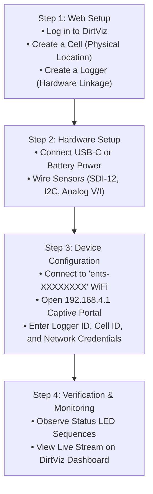

# User Guide Overview

This guide walks through the end-to-end process of setting up, configuring, and deploying an ENTS sensing node, and visualizing collected environmental data in the DirtViz web platform.

---

## Deployment Workflow

Setting up an ENTS sensor node involves four primary steps:

<figcaption style="margin-top: 0.5em; text-align: center; font-size: 0.85em; color: var(--md-default-fg-color--light);"><strong>Figure 1:</strong> Four-phase deployment workflow for field operators, connecting physical setup to cloud telemetry.</figcaption>

---

## Section Navigation

* **[DirtViz Web Platform](dirtviz.md)**: How to create accounts, set up virtual Cells, register hardware Loggers, view live streaming graphs, and download data as CSV.
* **[Hardware Setup and Wiring](hardware-setup.md)**: Power supply options, screw terminal wiring diagrams for SDI-12 and analog measurements, and sensor pinouts.
* **[Captive Portal Configuration](captive-portal.md)**: Connecting to the onboard ESP32 SoftAP hotspot (`ents-XXXXXXXX`), accessing the local webform at `http://192.168.4.1`, and saving network parameters.
* **[Diagnostics and LEDs](diagnostics.md)**: Understanding LED blink cadences, reset sequences, and reading diagnostic messages over the USB serial terminal.

---

## Quick Reference

| Parameter | Default Value | Notes |
| :--- | :--- | :--- |
| **Configuration WiFi SSID** | `ents-XXXXXXXX` | `XXXXXXXX` matches the board MAC address printed on the bottom silkscreen. |
| **Configuration WiFi Password** | `ilovedirt` | Required to join the device captive hotspot. |
| **Captive Portal URL** | `http://192.168.4.1` | Accessible only while connected to the board's WiFi. |
| **Power Requirements** | 5V DC, >= 500mA | Via USB-C port, or 3.7V Li-ion battery on header J9. |
| **Serial Console Baud Rate** | 115200 baud (8N1) | Silicon Labs CP2102 USB-to-UART bridge. |
| **Live Web Portal** | [dirtviz.jlab.ucsc.edu](https://dirtviz.jlab.ucsc.edu/) | Primary data access and dashboard portal. |
